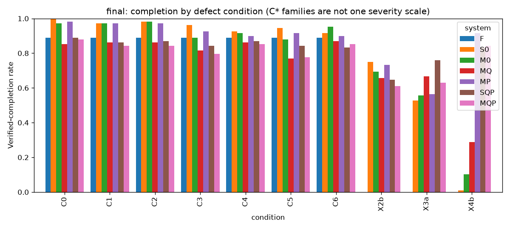
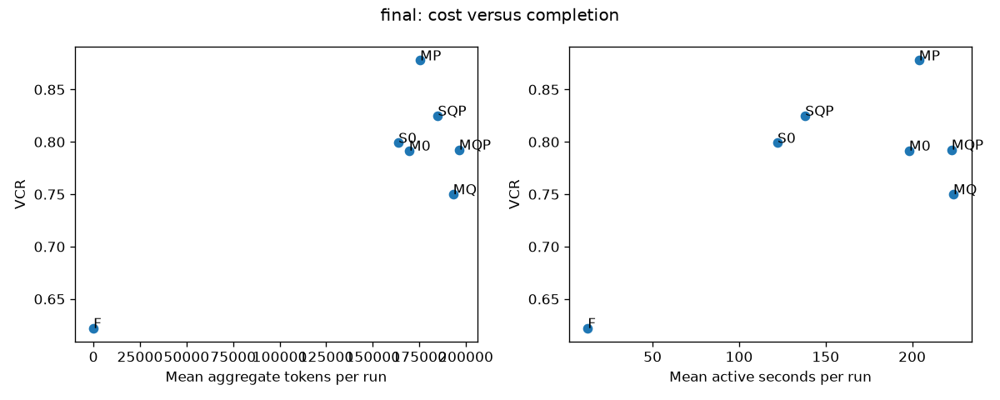
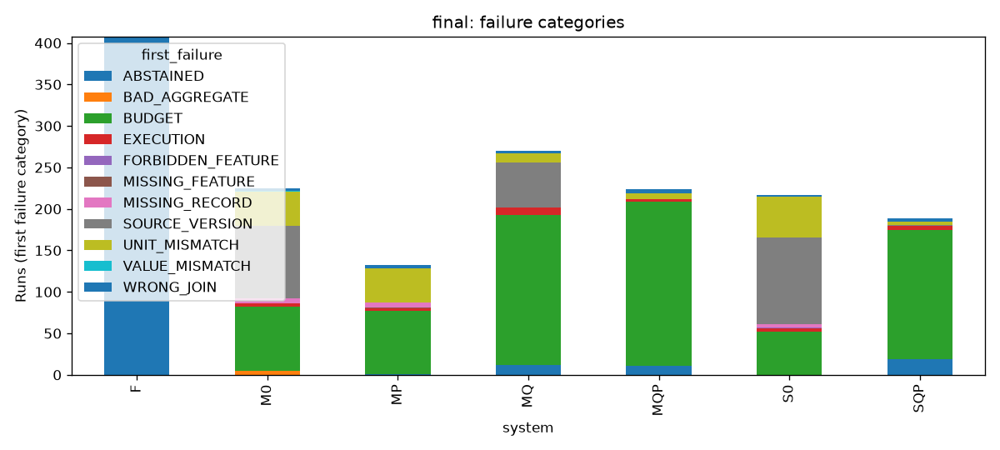

# Final E1 report (backbone A)

## 1. Verified-completion rate (recoverable runs)

| system | attempted | verified | VCR | VCR_family_weighted |
|---|---|---|---|---|
| F | 1080 | 672 | 0.622 | 0.622 |
| S0 | 1080 | 863 | 0.799 | 0.799 |
| M0 | 1080 | 855 | 0.792 | 0.792 |
| MQ | 1080 | 810 | 0.750 | 0.750 |
| MP | 1080 | 948 | 0.878 | 0.878 |
| SQP | 1080 | 891 | 0.825 | 0.825 |
| MQP | 1080 | 856 | 0.793 | 0.793 |

### By dataset family
| system | D1 | D2 | D3 | D4 | D5 | D6 |
|---|---|---|---|---|---|---|
| F | 0.700 | 0.467 | 0.700 | 0.467 | 0.700 | 0.700 |
| M0 | 0.811 | 0.667 | 0.794 | 0.806 | 0.833 | 0.839 |
| MP | 0.889 | 0.706 | 0.878 | 0.933 | 0.956 | 0.906 |
| MQ | 0.867 | 0.478 | 0.833 | 0.583 | 0.889 | 0.850 |
| MQP | 0.933 | 0.450 | 0.917 | 0.622 | 0.933 | 0.900 |
| S0 | 0.783 | 0.706 | 0.783 | 0.844 | 0.822 | 0.856 |
| SQP | 0.894 | 0.528 | 0.978 | 0.644 | 0.944 | 0.961 |

### By condition
| system | C0 | C1 | C2 | C3 | C4 | C5 | C6 | X2b | X3a | X4b |
|---|---|---|---|---|---|---|---|---|---|---|
| F | 0.889 | 0.889 | 0.889 | 0.889 | 0.889 | 0.889 | 0.889 | 0.000 | 0.000 | 0.000 |
| M0 | 0.972 | 0.972 | 0.981 | 0.889 | 0.917 | 0.880 | 0.954 | 0.694 | 0.556 | 0.102 |
| MP | 0.981 | 0.972 | 0.972 | 0.926 | 0.898 | 0.917 | 0.898 | 0.731 | 0.565 | 0.917 |
| MQ | 0.852 | 0.861 | 0.861 | 0.815 | 0.861 | 0.769 | 0.870 | 0.657 | 0.667 | 0.287 |
| MQP | 0.880 | 0.843 | 0.843 | 0.796 | 0.852 | 0.778 | 0.852 | 0.611 | 0.630 | 0.843 |
| S0 | 1.000 | 0.972 | 0.981 | 0.963 | 0.926 | 0.944 | 0.917 | 0.750 | 0.528 | 0.009 |
| SQP | 0.889 | 0.861 | 0.870 | 0.843 | 0.870 | 0.843 | 0.833 | 0.648 | 0.759 | 0.833 |

### Attempt counts by condition
| system | C0 | C1 | C2 | C3 | C4 | C5 | C6 | X2b | X3a | X4b |
|---|---|---|---|---|---|---|---|---|---|---|
| F | 108 | 108 | 108 | 108 | 108 | 108 | 108 | 108 | 108 | 108 |
| M0 | 108 | 108 | 108 | 108 | 108 | 108 | 108 | 108 | 108 | 108 |
| MP | 108 | 108 | 108 | 108 | 108 | 108 | 108 | 108 | 108 | 108 |
| MQ | 108 | 108 | 108 | 108 | 108 | 108 | 108 | 108 | 108 | 108 |
| MQP | 108 | 108 | 108 | 108 | 108 | 108 | 108 | 108 | 108 | 108 |
| S0 | 108 | 108 | 108 | 108 | 108 | 108 | 108 | 108 | 108 | 108 |
| SQP | 108 | 108 | 108 | 108 | 108 | 108 | 108 | 108 | 108 | 108 |

## 2. Paired effects (percentage points; family-weighted; block bootstrap within family)

| contrast | estimate_pp | ci_low_pp | ci_high_pp | p_sign_flip | families | blocks | paired_cells | lofo_min_pp | lofo_max_pp | role | p_holm |
|---|---|---|---|---|---|---|---|---|---|---|---|
| H1: MQP - M0 | 0.093 | -11.111 | 9.907 | 1.000 | 6 | 18 | 1080 | -2.333 | 4.444 | primary |  |
| Q main effect | -6.343 | -17.269 | 3.750 | 0.499 | 6 | 18 | 1080 | -8.611 | -2.278 | secondary | 0.499 |
| P main effect | 6.435 | 5.463 | 7.361 | 0.000 | 6 | 18 | 1080 | 6.056 | 7.611 | secondary | 0.000 |
| Q x P interaction | -4.352 | -6.204 | -2.500 | 0.004 | 6 | 18 | 1080 | -5.222 | -3.444 | secondary | 0.013 |
| MQP - SQP | -3.241 | -4.537 | -1.759 | 0.020 | 6 | 18 | 1080 | -4.667 | -2.333 | secondary | 0.041 |
| MQP - F | -5.423 | -7.937 | -2.513 | 0.000 | 6 | 18 | 756 | -6.190 | -2.857 | secondary | 0.001 |
| M0 - S0 | -0.741 | -1.852 | 0.463 | 0.477 | 6 | 18 | 1080 | -1.444 | -0.111 | exploratory |  |
| SQP - S0 | 2.593 | -8.611 | 12.685 | 0.713 | 6 | 18 | 1080 | -0.778 | 7.111 | exploratory |  |
| MQP - F (all tiers, exploratory) | 17.037 | 14.537 | 19.167 | 0.000 | 6 | 18 | 1080 | 15.778 | 20.778 | exploratory |  |

Failure to reject a difference is not evidence of equivalence. With three repetition blocks per family the bootstrap interval can be unstable.

## 3. Predictive quality
| system | verified_runs | mean_skill_verified | mean_unclipped_skill_all_scored | mean_verified_utility_all_attempts |
|---|---|---|---|---|
| F | 672 | 0.574 | 0.574 | 0.361 |
| M0 | 855 | 0.572 | 0.576 | 0.457 |
| MP | 948 | 0.567 | 0.570 | 0.503 |
| MQ | 810 | 0.568 | 0.570 | 0.430 |
| MQP | 856 | 0.566 | 0.565 | 0.454 |
| S0 | 863 | 0.572 | 0.576 | 0.462 |
| SQP | 891 | 0.569 | 0.569 | 0.475 |

### Raw metrics of verified runs
| family | system | n | ap | macro_f1 | rmse | mae |
|---|---|---|---|---|---|---|
| D1 | F | 126 | 0.692 | 0.813 |  |  |
| D1 | M0 | 146 | 0.695 | 0.814 |  |  |
| D1 | MP | 160 | 0.696 | 0.815 |  |  |
| D1 | MQ | 156 | 0.696 | 0.815 |  |  |
| D1 | MQP | 168 | 0.697 | 0.815 |  |  |
| D1 | S0 | 141 | 0.694 | 0.815 |  |  |
| D1 | SQP | 161 | 0.696 | 0.815 |  |  |
| D2 | F | 84 |  | 0.815 |  |  |
| D2 | M0 | 120 |  | 0.813 |  |  |
| D2 | MP | 127 |  | 0.812 |  |  |
| D2 | MQ | 86 |  | 0.818 |  |  |
| D2 | MQP | 81 |  | 0.819 |  |  |
| D2 | S0 | 127 |  | 0.813 |  |  |
| D2 | SQP | 95 |  | 0.817 |  |  |
| D3 | F | 126 |  |  | 6.775 | 5.136 |
| D3 | M0 | 143 |  |  | 6.785 | 5.144 |
| D3 | MP | 158 |  |  | 6.706 | 5.092 |
| D3 | MQ | 150 |  |  | 6.732 | 5.106 |
| D3 | MQP | 165 |  |  | 6.698 | 5.086 |
| D3 | S0 | 141 |  |  | 6.737 | 5.110 |
| D3 | SQP | 176 |  |  | 6.684 | 5.076 |
| D4 | F | 84 |  |  | 9.253 | 6.782 |
| D4 | M0 | 145 |  |  | 7.736 | 5.720 |
| D4 | MP | 168 |  |  | 7.735 | 5.713 |
| D4 | MQ | 105 |  |  | 9.347 | 6.828 |
| D4 | MQP | 112 |  |  | 9.431 | 6.884 |
| D4 | S0 | 152 |  |  | 7.760 | 5.737 |
| D4 | SQP | 116 |  |  | 9.486 | 6.915 |
| D5 | F | 126 | 0.401 | 0.573 |  |  |
| D5 | M0 | 150 | 0.401 | 0.573 |  |  |
| D5 | MP | 172 | 0.402 | 0.574 |  |  |
| D5 | MQ | 160 | 0.401 | 0.574 |  |  |
| D5 | MQP | 168 | 0.401 | 0.574 |  |  |
| D5 | S0 | 148 | 0.401 | 0.574 |  |  |
| D5 | SQP | 170 | 0.401 | 0.573 |  |  |
| D6 | F | 126 |  |  | 1.987 | 1.520 |
| D6 | M0 | 151 |  |  | 1.945 | 1.495 |
| D6 | MP | 163 |  |  | 1.930 | 1.486 |
| D6 | MQ | 153 |  |  | 1.942 | 1.493 |
| D6 | MQP | 162 |  |  | 1.927 | 1.485 |
| D6 | S0 | 154 |  |  | 1.946 | 1.496 |
| D6 | SQP | 173 |  |  | 1.915 | 1.477 |

## 4. Cost and efficiency
| system | runs | mean_tokens | p90_tokens | mean_model_calls | mean_tool_calls | mean_gate_calls | mean_repairs | mean_fits | mean_active_s | p90_active_s | mean_llm_s | verified | tokens_per_verified | active_s_per_verified |
|---|---|---|---|---|---|---|---|---|---|---|---|---|---|---|
| F | 1080 | 0.0 | 0.0 | 0.0 | 5.7 | 10.7 | 0.0 | 15.6 | 12.5 | 35.6 | 0.0 | 672 | 0.0 | 20.1 |
| M0 | 1080 | 169473.0 | 270270.9 | 25.2 | 21.6 | 0.0 | 0.0 | 23.7 | 198.2 | 267.6 | 179.5 | 855 | 214071.2 | 250.4 |
| MP | 1080 | 175402.2 | 266703.3 | 25.8 | 22.2 | 7.8 | 0.1 | 24.0 | 203.9 | 280.9 | 184.9 | 948 | 199825.2 | 232.3 |
| MQ | 1080 | 193121.4 | 303317.9 | 27.0 | 23.4 | 7.3 | 0.1 | 22.3 | 223.8 | 336.0 | 205.8 | 810 | 257495.2 | 298.4 |
| MQP | 1080 | 196307.5 | 304173.2 | 27.2 | 23.6 | 14.8 | 0.2 | 22.3 | 222.7 | 329.2 | 204.7 | 856 | 247677.7 | 281.0 |
| S0 | 1080 | 163794.3 | 232832.2 | 17.5 | 17.4 | 0.0 | 0.0 | 24.1 | 122.2 | 164.7 | 103.3 | 863 | 204980.1 | 152.9 |
| SQP | 1080 | 184938.4 | 305443.2 | 18.8 | 18.5 | 15.1 | 0.2 | 22.9 | 138.2 | 221.6 | 119.9 | 891 | 224167.7 | 167.5 |

## 5. Failure categories and reliability
| system | ABSTAINED | BAD_AGGREGATE | BUDGET | EXECUTION | FORBIDDEN_FEATURE | MISSING_FEATURE | MISSING_RECORD | SOURCE_VERSION | UNIT_MISMATCH | VALUE_MISMATCH | WRONG_JOIN |
|---|---|---|---|---|---|---|---|---|---|---|---|
| F | 408 | 0 | 0 | 0 | 0 | 0 | 0 | 0 | 0 | 0 | 0 |
| M0 | 0 | 5 | 77 | 4 | 0 | 0 | 6 | 88 | 41 | 1 | 3 |
| MP | 1 | 0 | 76 | 3 | 0 | 1 | 6 | 0 | 41 | 0 | 4 |
| MQ | 12 | 0 | 181 | 9 | 0 | 0 | 0 | 54 | 11 | 0 | 3 |
| MQP | 11 | 0 | 198 | 3 | 0 | 0 | 0 | 0 | 7 | 0 | 5 |
| S0 | 0 | 0 | 52 | 4 | 1 | 0 | 4 | 105 | 49 | 0 | 2 |
| SQP | 19 | 0 | 156 | 5 | 0 | 0 | 0 | 1 | 4 | 0 | 4 |
| system | invalid_submission_rate | submission_error_rate | recoverable_abstention_rate |
|---|---|---|---|
| F | 0.000 | 0.000 | 0.378 |
| M0 | 0.133 | 0.144 | 0.000 |
| MP | 0.048 | 0.052 | 0.001 |
| MQ | 0.063 | 0.077 | 0.011 |
| MQP | 0.011 | 0.014 | 0.010 |
| S0 | 0.149 | 0.157 | 0.000 |
| SQP | 0.008 | 0.010 | 0.018 |
### Terminal states
| system | ABSTAINED | BUDGET_EXCEEDED | EXECUTION_ERROR | SUBMITTED |
|---|---|---|---|---|
| F | 408 | 0 | 0 | 672 |
| M0 | 0 | 77 | 4 | 999 |
| MP | 1 | 76 | 3 | 1000 |
| MQ | 12 | 181 | 9 | 878 |
| MQP | 11 | 198 | 3 | 868 |
| S0 | 0 | 52 | 4 | 1024 |
| SQP | 19 | 156 | 5 | 900 |

## 6. Negative controls (unrecoverable tasks)
_no data_

## 7. Second-backbone replication (prespecified subset; limited model robustness, not generalization)
| system | runs_backbone_A | runs_backbone_B | VCR_backbone_A | VCR_backbone_B |
|---|---|---|---|---|
| M0 | 180 | 180 | 0.822 | 0.806 |
| MQP | 180 | 180 | 0.800 | 0.806 |
| SQP | 180 | 180 | 0.833 | 0.861 |

Backbone B MQP - M0: 0.0 pp

## 8. E5 refusal on unrecoverable tasks
| system | attempts | correct_refusal | false_submission |
|---|---|---|---|
| F | 36 | 1.000 | 0.000 |
| M0 | 36 | 0.944 | 0.056 |
| MP | 36 | 1.000 | 0.000 |
| MQ | 36 | 0.917 | 0.056 |
| MQP | 36 | 0.972 | 0.000 |
| S0 | 36 | 0.944 | 0.028 |
| SQP | 36 | 0.944 | 0.000 |

## 10. Replay, invariance and evaluator-fixture audit
Evaluator fixtures all passed: True. E6 retained submissions checked: 146; all passed: False.

## 11. Run accounting
| index | scheduled | recorded | pending | infrastructure_attempts |
|---|---|---|---|---|
| E0 | 336 | 336 | 0 | 0 |
| E0B | 6 | 6 | 0 | 0 |
| E1 | 7560 | 7560 | 0 | 10 |
| E4 | 540 | 540 | 0 | 0 |
| E5 | 252 | 252 | 0 | 0 |

## 12. GPU accounting (server sessions)
| time | experiment | backbone | gpu_seconds_total |
|---|---|---|---|
| 2026-11-11T05:15:36Z | E0 | A | 5253.762 |
| 2026-11-11T05:35:13Z | E0B | B | 339.468 |
| 2026-11-11T09:50:58Z | E0S | A | 12977.225 |
| 2026-11-11T14:15:03Z | E0X | A | 14198.768 |
| 2026-11-11T18:38:25Z | E0SB | B | 9924.616 |
| 2026-11-12T03:22:51Z | E0X2 | A | 30538.741 |
| 2026-11-12T07:31:03Z | E0SB | B | 10900.903 |
| 2026-11-12T13:26:53Z | E1 | A | 18262.849 |
| 2026-11-12T14:24:54Z | E1 | A | 2821.374 |
| 2026-11-14T14:59:56Z | E1 | A | 82109.076 |
| 2026-11-14T15:23:05Z | E5 | A | 83380.534 |
| 2026-11-14T19:35:58Z | E4 | B | 14635.783 |

## Tier-separated analyses (prespecified, main-plan-v2.1)

### Tier 1 (declared defects, C0-C6)
| contrast | estimate_pp | ci_low_pp | ci_high_pp | p_sign_flip | families | blocks | paired_cells | lofo_min_pp | lofo_max_pp | role |
|---|---|---|---|---|---|---|---|---|---|---|
| H1: MQP - M0 | -10.317 | -21.296 | -0.661 | 0.148 | 6 | 18 | 756 | -12.540 | -6.190 | primary |
| Q main effect | -9.987 | -21.098 | 0.265 | 0.240 | 6 | 18 | 756 | -12.222 | -5.714 | secondary |
| P main effect | -0.331 | -1.190 | 0.529 | 0.603 | 6 | 18 | 756 | -0.476 | -0.079 | secondary |
| Q x P interaction | -0.661 | -2.513 | 1.190 | 0.675 | 6 | 18 | 756 | -1.746 | 0.159 | secondary |
| MQP - SQP | -2.381 | -3.836 | -0.661 | 0.077 | 6 | 18 | 756 | -3.016 | -0.794 | secondary |
| MQP - F | -5.423 | -7.937 | -2.513 | 0.000 | 6 | 18 | 756 | -6.190 | -2.857 | secondary |

### Tier 2 (out-of-specification defects)
| contrast | estimate_pp | ci_low_pp | ci_high_pp | p_sign_flip | families | blocks | paired_cells | lofo_min_pp | lofo_max_pp | role | note |
|---|---|---|---|---|---|---|---|---|---|---|---|
| H1: MQP - M0 | 24.383 | 12.346 | 34.877 | 0.006 | 6.000 | 18.000 | 324.000 | 21.481 | 29.630 | primary |  |
| Q main effect | 2.160 | -8.951 | 12.037 | 0.763 | 6.000 | 18.000 | 324.000 | -0.185 | 5.741 | secondary |  |
| P main effect | 22.222 | 19.753 | 24.691 | 0.000 | 6.000 | 18.000 | 324.000 | 20.926 | 26.296 | secondary |  |
| Q x P interaction | -12.963 | -18.519 | -7.407 | 0.002 | 6.000 | 18.000 | 324.000 | -15.556 | -10.741 | secondary |  |
| MQP - SQP | -5.247 | -8.025 | -2.469 | 0.107 | 6.000 | 18.000 | 324.000 | -8.889 | -2.963 | secondary |  |
| MQP - F |  |  |  |  |  |  |  |  |  |  | insufficient paired data |

### Sensitivity: Tier 2 excluding X4
| contrast | estimate_pp | ci_low_pp | ci_high_pp | p_sign_flip | families | blocks | paired_cells | lofo_min_pp | lofo_max_pp | role | note |
|---|---|---|---|---|---|---|---|---|---|---|---|
| H1: MQP - M0 | -0.463 | -12.500 | 10.648 | 1.000 | 6.000 | 18.000 | 216.000 | -5.000 | 5.000 | primary |  |
| Q main effect | 0.463 | -10.880 | 10.417 | 0.972 | 6.000 | 18.000 | 216.000 | -3.611 | 4.722 | secondary |  |
| P main effect | -0.926 | -3.935 | 1.852 | 0.788 | 6.000 | 18.000 | 216.000 | -3.056 | 1.944 | secondary |  |
| Q x P interaction | -6.481 | -13.889 | 0.926 | 0.232 | 6.000 | 18.000 | 216.000 | -9.444 | -3.889 | secondary |  |
| MQP - SQP | -8.333 | -12.963 | -4.167 | 0.054 | 6.000 | 18.000 | 216.000 | -12.778 | -5.000 | secondary |  |
| MQP - F |  |  |  |  |  |  |  |  |  |  | insufficient paired data |

### Sensitivity: all recoverable tasks excluding X4
| contrast | estimate_pp | ci_low_pp | ci_high_pp | p_sign_flip | families | blocks | paired_cells | lofo_min_pp | lofo_max_pp | role |
|---|---|---|---|---|---|---|---|---|---|---|
| H1: MQP - M0 | -8.128 | -19.136 | 1.440 | 0.406 | 6 | 18 | 972 | -10.864 | -3.827 | primary |
| Q main effect | -7.665 | -18.724 | 2.418 | 0.479 | 6 | 18 | 972 | -10.247 | -3.395 | secondary |
| P main effect | -0.463 | -1.440 | 0.514 | 0.584 | 6 | 18 | 972 | -1.049 | 0.123 | secondary |
| Q x P interaction | -1.955 | -3.807 | -0.206 | 0.148 | 6 | 18 | 972 | -2.840 | -1.111 | secondary |
| MQP - SQP | -3.704 | -5.247 | -1.955 | 0.016 | 6 | 18 | 972 | -5.062 | -2.469 | secondary |
| MQP - F | -5.423 | -7.937 | -2.513 | 0.000 | 6 | 18 | 756 | -6.190 | -2.857 | secondary |

### Tier-2 minus Tier-1 difference of each contrast
| contrast | estimate_pp | ci_low_pp | ci_high_pp | p_sign_flip | blocks |
|---|---|---|---|---|---|
| H1: MQP - M0 | 34.700 | 30.247 | 38.845 | 0.000 | 18 |
| Q main effect | 12.147 | 9.061 | 15.256 | 0.000 | 18 |
| P main effect | 22.553 | 19.907 | 25.198 | 0.000 | 18 |
| Q x P interaction | -12.302 | -18.387 | -5.996 | 0.005 | 18 |
| MQP - SQP | -2.866 | -6.305 | 0.220 | 0.385 | 18 |
| MQP - F | 74.868 | 62.698 | 85.802 | 0.000 | 18 |

Per-tier and sensitivity estimates are prespecified secondary analyses; the primary H1 remains the pooled estimate over all recoverable tasks. They are not Holm-adjusted.

## Backbone B by tier
| system | Tier 1 | Tier 2 |
|---|---|---|
| M0 | 0.968 | 0.426 |
| MQP | 0.810 | 0.796 |
| SQP | 0.865 | 0.852 |

## Figures

