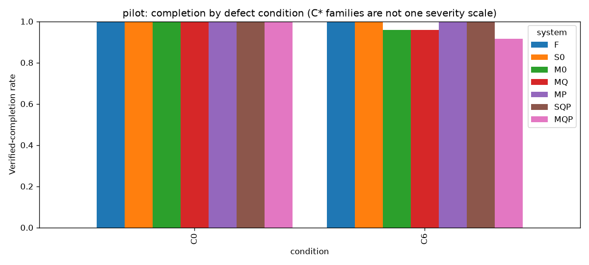
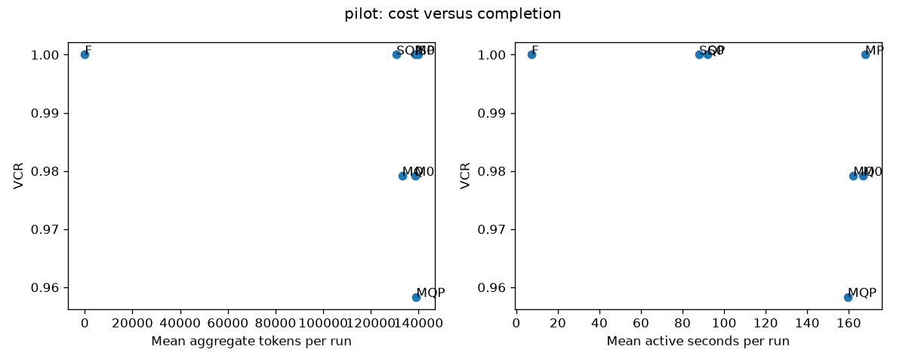
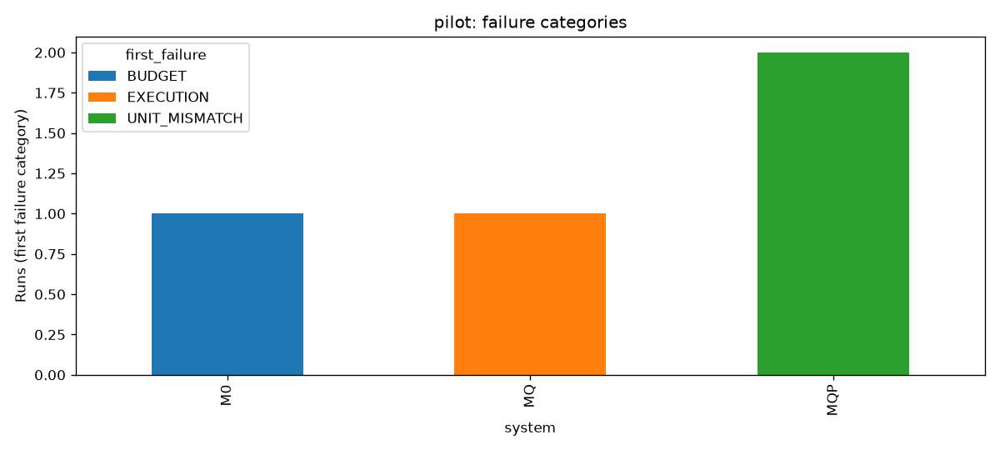

# Pilot E0 report

> Pilot (E0) on separate development tasks. Not part of confirmatory scores. Used to calibrate limits, estimate variance and cost, and freeze the protocol.

## 1. Verified-completion rate (recoverable runs)

| system | attempted | verified | VCR | VCR_family_weighted |
|---|---|---|---|---|
| F | 48 | 48 | 1.000 | 1.000 |
| S0 | 48 | 48 | 1.000 | 1.000 |
| M0 | 48 | 47 | 0.979 | 0.979 |
| MQ | 48 | 47 | 0.979 | 0.979 |
| MP | 48 | 48 | 1.000 | 1.000 |
| SQP | 48 | 48 | 1.000 | 1.000 |
| MQP | 48 | 46 | 0.958 | 0.958 |

### By dataset family
| system | D5 | D6 |
|---|---|---|
| F | 1.000 | 1.000 |
| M0 | 1.000 | 0.958 |
| MP | 1.000 | 1.000 |
| MQ | 0.958 | 1.000 |
| MQP | 0.958 | 0.958 |
| S0 | 1.000 | 1.000 |
| SQP | 1.000 | 1.000 |

### By condition
| system | C0 | C6 |
|---|---|---|
| F | 1.000 | 1.000 |
| M0 | 1.000 | 0.958 |
| MP | 1.000 | 1.000 |
| MQ | 1.000 | 0.958 |
| MQP | 1.000 | 0.917 |
| S0 | 1.000 | 1.000 |
| SQP | 1.000 | 1.000 |

### Attempt counts by condition
| system | C0 | C6 |
|---|---|---|
| F | 24 | 24 |
| M0 | 24 | 24 |
| MP | 24 | 24 |
| MQ | 24 | 24 |
| MQP | 24 | 24 |
| S0 | 24 | 24 |
| SQP | 24 | 24 |

## 2. Paired effects (percentage points; family-weighted; block bootstrap within family)

| contrast | estimate_pp | ci_low_pp | ci_high_pp | p_sign_flip | families | blocks | paired_cells | lofo_min_pp | lofo_max_pp | role | p_holm |
|---|---|---|---|---|---|---|---|---|---|---|---|
| H1: MQP - M0 | -2.083 | -8.333 | 4.167 | 1.000 | 2 | 4 | 48 | -4.167 | 0.000 | primary |  |
| Q main effect | -2.083 | -4.167 | 0.000 | 0.624 | 2 | 4 | 48 | -4.167 | 0.000 | secondary | 1.000 |
| P main effect | 0.000 | -4.167 | 4.167 | 1.000 | 2 | 4 | 48 | 0.000 | 0.000 | secondary | 1.000 |
| Q x P interaction | -4.167 | -8.333 | 0.000 | 0.627 | 2 | 4 | 48 | -8.333 | 0.000 | secondary | 1.000 |
| MQP - SQP | -4.167 | -8.333 | 0.000 | 0.501 | 2 | 4 | 48 | -4.167 | -4.167 | secondary | 1.000 |
| MQP - F | -4.167 | -8.333 | 0.000 | 0.501 | 2 | 4 | 48 | -4.167 | -4.167 | secondary | 1.000 |
| M0 - S0 | -2.083 | -4.167 | 0.000 | 1.000 | 2 | 4 | 48 | -4.167 | 0.000 | exploratory |  |
| SQP - S0 | 0.000 | 0.000 | 0.000 | 1.000 | 2 | 4 | 48 | 0.000 | 0.000 | exploratory |  |

Failure to reject a difference is not evidence of equivalence. With three repetition blocks per family the bootstrap interval can be unstable.

## 3. Predictive quality
| system | verified_runs | mean_skill_verified | mean_unclipped_skill_all_scored | mean_verified_utility_all_attempts |
|---|---|---|---|---|
| F | 48 | 0.494 | 0.494 | 0.494 |
| M0 | 47 | 0.488 | 0.488 | 0.478 |
| MP | 48 | 0.494 | 0.494 | 0.494 |
| MQ | 47 | 0.498 | 0.498 | 0.488 |
| MQP | 46 | 0.494 | 0.493 | 0.474 |
| S0 | 48 | 0.494 | 0.494 | 0.494 |
| SQP | 48 | 0.494 | 0.494 | 0.494 |

### Raw metrics of verified runs
| family | system | n | ap | macro_f1 | rmse | mae |
|---|---|---|---|---|---|---|
| D5 | F | 24 | 0.334 | 0.523 |  |  |
| D5 | M0 | 24 | 0.334 | 0.527 |  |  |
| D5 | MP | 24 | 0.334 | 0.523 |  |  |
| D5 | MQ | 23 | 0.332 | 0.522 |  |  |
| D5 | MQP | 23 | 0.336 | 0.524 |  |  |
| D5 | S0 | 24 | 0.334 | 0.523 |  |  |
| D5 | SQP | 24 | 0.334 | 0.523 |  |  |
| D6 | F | 24 |  |  | 2.054 | 1.631 |
| D6 | M0 | 23 |  |  | 2.052 | 1.628 |
| D6 | MP | 24 |  |  | 2.054 | 1.631 |
| D6 | MQ | 24 |  |  | 2.054 | 1.631 |
| D6 | MQP | 23 |  |  | 2.056 | 1.633 |
| D6 | S0 | 24 |  |  | 2.054 | 1.631 |
| D6 | SQP | 24 |  |  | 2.054 | 1.631 |

## 4. Cost and efficiency
| system | runs | mean_tokens | p90_tokens | mean_model_calls | mean_tool_calls | mean_gate_calls | mean_repairs | mean_fits | mean_active_s | p90_active_s | mean_llm_s | verified | tokens_per_verified | active_s_per_verified |
|---|---|---|---|---|---|---|---|---|---|---|---|---|---|---|
| F | 48 | 0.0 | 0.0 | 0.0 | 8.0 | 16.0 | 0.0 | 25.0 | 7.3 | 8.1 | 0.0 | 48 | 0.0 | 7.3 |
| M0 | 48 | 138480.7 | 211472.0 | 23.4 | 19.7 | 0.0 | 0.0 | 25.0 | 166.9 | 213.7 | 159.3 | 47 | 141427.1 | 170.5 |
| MP | 48 | 138667.8 | 194645.4 | 24.0 | 20.2 | 8.1 | 0.0 | 25.0 | 167.9 | 219.6 | 160.2 | 48 | 138667.8 | 167.9 |
| MQ | 48 | 133153.8 | 174187.7 | 23.0 | 19.1 | 7.8 | 0.0 | 24.5 | 162.2 | 190.5 | 154.7 | 47 | 135986.8 | 165.6 |
| MQP | 48 | 139033.0 | 203949.4 | 23.0 | 19.6 | 16.1 | 0.0 | 25.0 | 159.5 | 205.3 | 151.8 | 46 | 145077.9 | 166.4 |
| S0 | 48 | 139932.9 | 184610.3 | 15.8 | 15.8 | 0.0 | 0.0 | 25.0 | 92.1 | 109.9 | 84.6 | 48 | 139932.9 | 92.1 |
| SQP | 48 | 130743.6 | 176908.4 | 15.1 | 15.1 | 16.0 | 0.0 | 25.0 | 88.0 | 108.5 | 80.5 | 48 | 130743.6 | 88.0 |

## 5. Failure categories and reliability
| system | BUDGET | EXECUTION | UNIT_MISMATCH |
|---|---|---|---|
| M0 | 1 | 0 | 0 |
| MQ | 0 | 1 | 0 |
| MQP | 0 | 0 | 2 |
| system | invalid_submission_rate | submission_error_rate | recoverable_abstention_rate |
|---|---|---|---|
| F | 0.000 | 0.000 | 0.000 |
| M0 | 0.000 | 0.000 | 0.000 |
| MP | 0.000 | 0.000 | 0.000 |
| MQ | 0.000 | 0.000 | 0.000 |
| MQP | 0.042 | 0.042 | 0.000 |
| S0 | 0.000 | 0.000 | 0.000 |
| SQP | 0.000 | 0.000 | 0.000 |
### Terminal states
| system | BUDGET_EXCEEDED | EXECUTION_ERROR | SUBMITTED |
|---|---|---|---|
| F | 0 | 0 | 48 |
| M0 | 1 | 0 | 47 |
| MP | 0 | 0 | 48 |
| MQ | 0 | 1 | 47 |
| MQP | 0 | 0 | 48 |
| S0 | 0 | 0 | 48 |
| SQP | 0 | 0 | 48 |

## 6. Negative controls (unrecoverable tasks)
_no data_

## 7. Usage percentiles (agentic runs ending SUBMITTED or ABSTAINED)
| index | p50 | p90 | p95 | p100 |
|---|---|---|---|---|
| tokens | 127751 | 188779 | 213397 | 275304 |
| model_calls | 20 | 28 | 31 | 36 |
| tool_calls | 17 | 25 | 28 | 33 |
| active_s | 138 | 200 | 214 | 282 |
| repairs | 0 | 0 | 0 | 2 |
| evaluations | 6 | 6 | 6 | 6 |

## 8. Budget exhaustion
| system | budget_exceeded_rate |
|---|---|
| M0 | 0.021 |
| MP | 0.000 |
| MQ | 0.000 |
| MQP | 0.000 |
| S0 | 0.000 |
| SQP | 0.000 |

## 9. Throughput and run-time estimates
```
agentic_runs                  288.000000
mean_active_s                 139.422257
mean_llm_s                    131.841385
concurrency                     8.000000
stage_wall_seconds           5230.300000
seconds_per_run_effective      15.566369
```
| repetitions | E1 | E4 | E5 | total | estimated_hours | estimated_sessions | estimated_gpu_hours |
|---|---|---|---|---|---|---|---|
| 3.000 | 5292.000 | 378.000 | 252.000 | 5922.000 | 25.600 | 3.000 | 25.600 |
| 4.000 | 7056.000 | 504.000 | 336.000 | 7896.000 | 34.100 | 4.000 | 34.100 |
| 5.000 | 8820.000 | 630.000 | 420.000 | 9870.000 | 42.700 | 5.000 | 42.700 |
| 6.000 | 10584.000 | 756.000 | 504.000 | 11844.000 | 51.200 | 6.000 | 51.200 |

## 10. Power simulation (10-point VCR improvement, planned paired analysis)
| reps | sd_block_logit | power |
|---|---|---|
| 3.000 | 0.250 | 1.000 |
| 4.000 | 0.250 | 1.000 |
| 5.000 | 0.250 | 1.000 |
| 6.000 | 0.250 | 1.000 |
| 3.000 | 0.500 | 1.000 |
| 4.000 | 0.500 | 1.000 |
| 5.000 | 0.500 | 1.000 |
| 6.000 | 0.500 | 1.000 |
| 3.000 | 1.000 | 1.000 |
| 4.000 | 1.000 | 1.000 |
| 5.000 | 1.000 | 1.000 |
| 6.000 | 1.000 | 1.000 |

Assumptions: {'baseline_vcr_M0_pilot': 0.9791666666666666, 'effect_pp': 10.0, 'sd_family_logit': 0.5, 'sd_cell_logit': 0.5, 'sims': 200, 'note': 'Development pilot tasks differ from the evaluation portfolio; the variance model is an assumption.'}

## 11. Freeze proposal
Frozen limits by the prespecified rule: `{'aggregate_tokens': 267000, 'model_calls': 48, 'tool_calls': 40, 'repair_cycles': 2, 'pipeline_evaluations': 6, 'wall_seconds': 600}` (n=286).

Protocol-text limits: `{'aggregate_tokens': 30000, 'model_calls': 48, 'tool_calls': 40, 'repair_cycles': 2, 'pipeline_evaluations': 6, 'wall_seconds': 600}`.

Recommended repetitions: [0, 1, 2].

## 12. Evaluator fixtures
| codes | expected | fixture | passed | verified |
|---|---|---|---|---|
| [] | VERIFIED | correct_T3_C4 | True | 1.000 |
| [] | VERIFIED | valid_alt_inner_join_T3_C4 | True | 1.000 |
| [] | VERIFIED | valid_alt_explicit_version_T3_C4 | True | 1.000 |
| ['MISSING_RECORD', 'INVALID_PREDICTION'] | MISSING_RECORD | wrong_join_unmapped_alias_T3_C4 | True | 0.000 |
| ['ROW_MULTIPLICITY', 'INVALID_PREDICTION'] | ROW_MULTIPLICITY | duplicated_predictions_T3_C4 | True | 0.000 |
| [] | VERIFIED | correct_T6_C6 | True | 1.000 |
| ['SOURCE_VERSION', 'VALUE_MISMATCH'] | SOURCE_VERSION | wrong_version_T6_C6 | True | 0.000 |
| ['UNIT_MISMATCH'] | UNIT_MISMATCH | unit_mismatch_T6_C6 | True | 0.000 |
| ['BAD_AGGREGATE'] | BAD_AGGREGATE | bad_aggregate_T6_C6 | True | 0.000 |
| ['FORBIDDEN_FEATURE'] | FORBIDDEN_FEATURE | forbidden_predictor_T6_C6 | True | 0.000 |
| ['SOURCE_VERSION', 'VALUE_MISMATCH'] | SOURCE_VERSION | wrong_version_T5_C0 | True | 0.000 |
| ['MISSING_RECORD', 'INVALID_PREDICTION'] | MISSING_RECORD | missing_records_drop_rows_T1_C2 | True | 0.000 |
| ['FORBIDDEN_FEATURE'] | FORBIDDEN_FEATURE | forbidden_identifier_T1_C0 | True | 0.000 |
| ['ARTIFACT_MISMATCH'] | ARTIFACT_MISMATCH | changed_artifact_hash_T1_C0 | True | 0.000 |
| ['INVALID_PREDICTION'] | INVALID_PREDICTION | invalid_probabilities_T1_C0 | True | 0.000 |
| [] | equal | equivalent_numeric_representations | True |  |

## 13. Backbone-B smoke test (unscored)
| system | runs | verified | terminal |
|---|---|---|---|
| M0 | 2 | 2 | SUBMITTED |
| MQP | 2 | 2 | SUBMITTED |
| SQP | 2 | 2 | SUBMITTED |

## 14. Unexpected agent-loop exceptions
0 runs recorded an internal exception (should be 0).

## 15. Ceiling check (main-plan-v2.md, E0)
M0 pilot VCR: 0.979 (threshold 0.95). Agentic systems at 100%: MP, S0, SQP.
**CEILING WARNING:** revise task difficulty (conditions or tasks) before the freeze and record the change; do not substitute a weaker backbone.

## Figures



