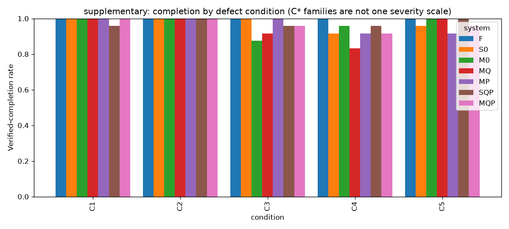
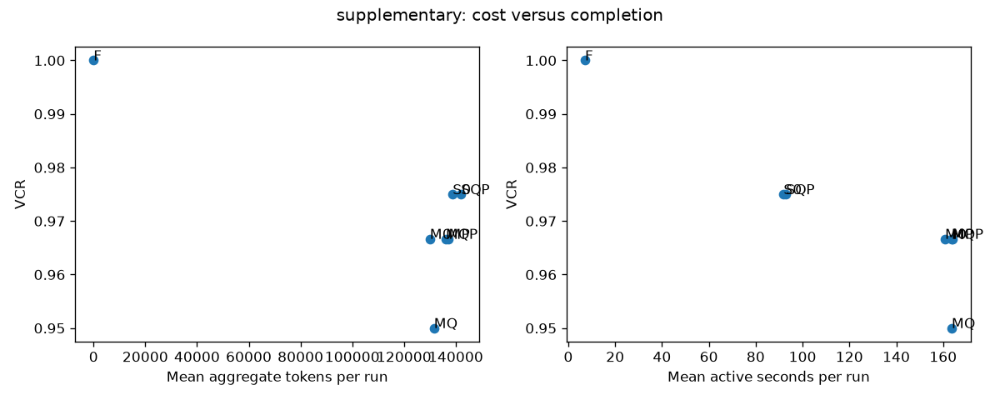
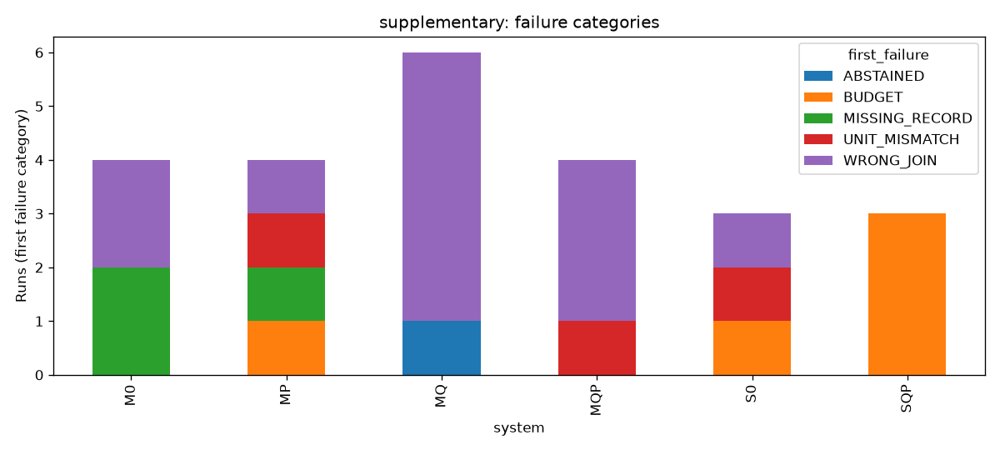
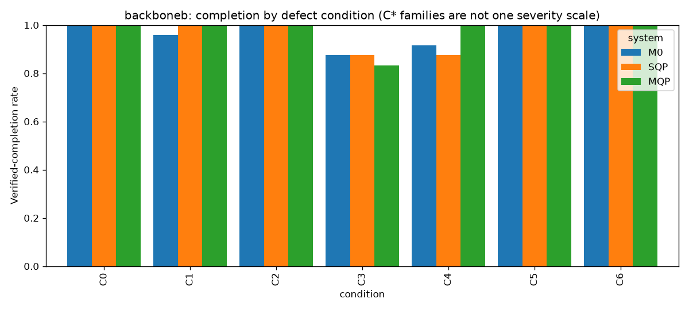
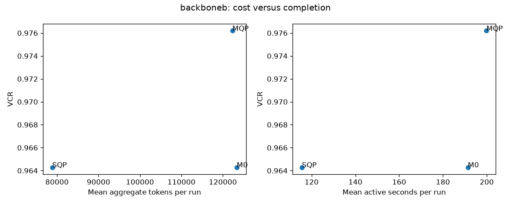
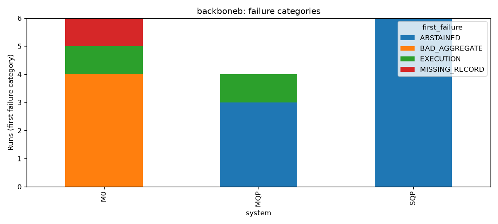

# Supplementary pilot E0S report (backbone A, C1-C5)

> Pilot (E0) on separate development tasks. Not part of confirmatory scores. Used to calibrate limits, estimate variance and cost, and freeze the protocol.

> Supplementary pilot, recorded separately from E0 (Section 12).

## 1. Verified-completion rate (recoverable runs)

| system | attempted | verified | VCR | VCR_family_weighted |
|---|---|---|---|---|
| F | 120 | 120 | 1.000 | 1.000 |
| S0 | 120 | 117 | 0.975 | 0.975 |
| M0 | 120 | 116 | 0.967 | 0.967 |
| MQ | 120 | 114 | 0.950 | 0.950 |
| MP | 120 | 116 | 0.967 | 0.967 |
| SQP | 120 | 117 | 0.975 | 0.975 |
| MQP | 120 | 116 | 0.967 | 0.967 |

### By dataset family
| system | D5 | D6 |
|---|---|---|
| F | 1.000 | 1.000 |
| M0 | 0.967 | 0.967 |
| MP | 0.967 | 0.967 |
| MQ | 0.950 | 0.950 |
| MQP | 0.967 | 0.967 |
| S0 | 0.983 | 0.967 |
| SQP | 0.983 | 0.967 |

### By condition
| system | C1 | C2 | C3 | C4 | C5 |
|---|---|---|---|---|---|
| F | 1.000 | 1.000 | 1.000 | 1.000 | 1.000 |
| M0 | 1.000 | 1.000 | 0.875 | 0.958 | 1.000 |
| MP | 1.000 | 1.000 | 1.000 | 0.917 | 0.917 |
| MQ | 1.000 | 1.000 | 0.917 | 0.833 | 1.000 |
| MQP | 1.000 | 1.000 | 0.958 | 0.917 | 0.958 |
| S0 | 1.000 | 1.000 | 1.000 | 0.917 | 0.958 |
| SQP | 0.958 | 1.000 | 0.958 | 0.958 | 1.000 |

### Attempt counts by condition
| system | C1 | C2 | C3 | C4 | C5 |
|---|---|---|---|---|---|
| F | 24 | 24 | 24 | 24 | 24 |
| M0 | 24 | 24 | 24 | 24 | 24 |
| MP | 24 | 24 | 24 | 24 | 24 |
| MQ | 24 | 24 | 24 | 24 | 24 |
| MQP | 24 | 24 | 24 | 24 | 24 |
| S0 | 24 | 24 | 24 | 24 | 24 |
| SQP | 24 | 24 | 24 | 24 | 24 |

## 2. Paired effects (percentage points; family-weighted; block bootstrap within family)

| contrast | estimate_pp | ci_low_pp | ci_high_pp | p_sign_flip | families | blocks | paired_cells | lofo_min_pp | lofo_max_pp | role | p_holm |
|---|---|---|---|---|---|---|---|---|---|---|---|
| H1: MQP - M0 | 0.000 | -1.667 | 1.667 | 1.000 | 2 | 4 | 120 | 0.000 | 0.000 | primary |  |
| Q main effect | -0.833 | -1.667 | 0.000 | 0.508 | 2 | 4 | 120 | -0.833 | -0.833 | secondary | 1.000 |
| P main effect | 0.833 | -0.833 | 2.500 | 0.763 | 2 | 4 | 120 | 0.833 | 0.833 | secondary | 1.000 |
| Q x P interaction | 1.667 | 0.000 | 3.333 | 0.508 | 2 | 4 | 120 | 1.667 | 1.667 | secondary | 1.000 |
| MQP - SQP | -0.833 | -1.667 | 0.000 | 1.000 | 2 | 4 | 120 | -1.667 | 0.000 | secondary | 1.000 |
| MQP - F | -3.333 | -3.333 | -3.333 | 0.117 | 2 | 4 | 120 | -3.333 | -3.333 | secondary | 0.587 |
| M0 - S0 | -0.833 | -3.333 | 1.667 | 1.000 | 2 | 4 | 120 | -1.667 | 0.000 | exploratory |  |
| SQP - S0 | 0.000 | -1.667 | 1.667 | 1.000 | 2 | 4 | 120 | 0.000 | 0.000 | exploratory |  |

Failure to reject a difference is not evidence of equivalence. With three repetition blocks per family the bootstrap interval can be unstable.

## 3. Predictive quality
| system | verified_runs | mean_skill_verified | mean_unclipped_skill_all_scored | mean_verified_utility_all_attempts |
|---|---|---|---|---|
| F | 120 | 0.472 | 0.472 | 0.472 |
| M0 | 116 | 0.472 | 0.472 | 0.456 |
| MP | 116 | 0.471 | 0.469 | 0.456 |
| MQ | 114 | 0.471 | 0.470 | 0.448 |
| MQP | 116 | 0.471 | 0.472 | 0.456 |
| S0 | 117 | 0.470 | 0.474 | 0.458 |
| SQP | 117 | 0.470 | 0.470 | 0.458 |

### Raw metrics of verified runs
| family | system | n | ap | macro_f1 | rmse | mae |
|---|---|---|---|---|---|---|
| D5 | F | 60 | 0.331 | 0.521 |  |  |
| D5 | M0 | 58 | 0.332 | 0.522 |  |  |
| D5 | MP | 58 | 0.330 | 0.521 |  |  |
| D5 | MQ | 57 | 0.331 | 0.522 |  |  |
| D5 | MQP | 58 | 0.330 | 0.521 |  |  |
| D5 | S0 | 59 | 0.331 | 0.522 |  |  |
| D5 | SQP | 59 | 0.331 | 0.522 |  |  |
| D6 | F | 60 |  |  | 2.382 | 1.841 |
| D6 | M0 | 58 |  |  | 2.393 | 1.848 |
| D6 | MP | 58 |  |  | 2.393 | 1.848 |
| D6 | MQ | 57 |  |  | 2.400 | 1.853 |
| D6 | MQP | 58 |  |  | 2.393 | 1.848 |
| D6 | S0 | 58 |  |  | 2.392 | 1.846 |
| D6 | SQP | 58 |  |  | 2.391 | 1.847 |

## 4. Cost and efficiency
| system | runs | mean_tokens | p90_tokens | mean_model_calls | mean_tool_calls | mean_gate_calls | mean_repairs | mean_fits | mean_active_s | p90_active_s | mean_llm_s | verified | tokens_per_verified | active_s_per_verified |
|---|---|---|---|---|---|---|---|---|---|---|---|---|---|---|
| F | 120 | 0.0 | 0.0 | 0.0 | 8.0 | 16.0 | 0.0 | 25.0 | 7.1 | 7.8 | 0.0 | 120 | 0.0 | 7.1 |
| M0 | 120 | 129986.2 | 200498.2 | 22.8 | 19.3 | 0.0 | 0.0 | 25.0 | 160.8 | 219.8 | 153.4 | 116 | 134468.5 | 166.4 |
| MP | 120 | 137271.6 | 217924.1 | 23.7 | 20.1 | 8.1 | 0.1 | 25.0 | 164.0 | 212.9 | 156.5 | 116 | 142005.1 | 169.7 |
| MQ | 120 | 131573.5 | 213669.8 | 23.1 | 19.5 | 8.1 | 0.1 | 25.0 | 163.6 | 215.8 | 156.2 | 114 | 138498.5 | 172.2 |
| MQP | 120 | 136135.2 | 218656.8 | 23.3 | 19.8 | 16.1 | 0.1 | 25.0 | 163.6 | 215.6 | 156.1 | 116 | 140829.5 | 169.2 |
| S0 | 120 | 138836.0 | 179228.8 | 16.1 | 16.1 | 0.0 | 0.0 | 25.0 | 91.9 | 113.4 | 84.5 | 117 | 142395.9 | 94.3 |
| SQP | 120 | 142052.0 | 184858.6 | 16.2 | 16.2 | 15.7 | 0.1 | 24.5 | 93.0 | 120.3 | 85.7 | 117 | 145694.3 | 95.4 |

## 5. Failure categories and reliability
| system | ABSTAINED | BUDGET | MISSING_RECORD | UNIT_MISMATCH | WRONG_JOIN |
|---|---|---|---|---|---|
| M0 | 0 | 0 | 2 | 0 | 2 |
| MP | 0 | 1 | 1 | 1 | 1 |
| MQ | 1 | 0 | 0 | 0 | 5 |
| MQP | 0 | 0 | 0 | 1 | 3 |
| S0 | 0 | 1 | 0 | 1 | 1 |
| SQP | 0 | 3 | 0 | 0 | 0 |
| system | invalid_submission_rate | submission_error_rate | recoverable_abstention_rate |
|---|---|---|---|
| F | 0.000 | 0.000 | 0.000 |
| M0 | 0.033 | 0.033 | 0.000 |
| MP | 0.025 | 0.025 | 0.000 |
| MQ | 0.042 | 0.042 | 0.008 |
| MQP | 0.033 | 0.033 | 0.000 |
| S0 | 0.017 | 0.017 | 0.000 |
| SQP | 0.000 | 0.000 | 0.000 |
### Terminal states
| system | ABSTAINED | BUDGET_EXCEEDED | SUBMITTED |
|---|---|---|---|
| F | 0 | 0 | 120 |
| M0 | 0 | 0 | 120 |
| MP | 0 | 1 | 119 |
| MQ | 1 | 0 | 119 |
| MQP | 0 | 0 | 120 |
| S0 | 0 | 1 | 119 |
| SQP | 0 | 3 | 117 |

## 6. Negative controls (unrecoverable tasks)
_no data_

## 15. Ceiling check (main-plan-v2.md, E0)
M0 pilot VCR: 0.967 (threshold 0.95). Agentic systems at 100%: none.
**CEILING WARNING:** revise task difficulty (conditions or tasks) before the freeze and record the change; do not substitute a weaker backbone.

## Figures

# BackboneB supplementary pilot E0SB report (M0, SQP, MQP; C0-C6)

> Pilot (E0) on separate development tasks. Not part of confirmatory scores. Used to calibrate limits, estimate variance and cost, and freeze the protocol.

> Supplementary pilot, recorded separately from E0 (Section 12).

## 1. Verified-completion rate (recoverable runs)

| system | attempted | verified | VCR | VCR_family_weighted |
|---|---|---|---|---|
| M0 | 168 | 162 | 0.964 | 0.964 |
| SQP | 168 | 162 | 0.964 | 0.964 |
| MQP | 168 | 164 | 0.976 | 0.976 |

### By dataset family
| system | D5 | D6 |
|---|---|---|
| M0 | 0.964 | 0.964 |
| MQP | 0.988 | 0.964 |
| SQP | 0.964 | 0.964 |

### By condition
| system | C0 | C1 | C2 | C3 | C4 | C5 | C6 |
|---|---|---|---|---|---|---|---|
| M0 | 1.000 | 0.958 | 1.000 | 0.875 | 0.917 | 1.000 | 1.000 |
| MQP | 1.000 | 1.000 | 1.000 | 0.833 | 1.000 | 1.000 | 1.000 |
| SQP | 1.000 | 1.000 | 1.000 | 0.875 | 0.875 | 1.000 | 1.000 |

### Attempt counts by condition
| system | C0 | C1 | C2 | C3 | C4 | C5 | C6 |
|---|---|---|---|---|---|---|---|
| M0 | 24 | 24 | 24 | 24 | 24 | 24 | 24 |
| MQP | 24 | 24 | 24 | 24 | 24 | 24 | 24 |
| SQP | 24 | 24 | 24 | 24 | 24 | 24 | 24 |

## 2. Paired effects (percentage points; family-weighted; block bootstrap within family)

| contrast | estimate_pp | ci_low_pp | ci_high_pp | p_sign_flip | families | blocks | paired_cells | lofo_min_pp | lofo_max_pp | role | note | p_holm |
|---|---|---|---|---|---|---|---|---|---|---|---|---|
| H1: MQP - M0 | 1.190 | 0.000 | 2.381 | 0.608 | 2.000 | 4.000 | 168.000 | 0.000 | 2.381 | primary |  |  |
| Q main effect |  |  |  |  |  |  |  |  |  |  | insufficient paired data |  |
| P main effect |  |  |  |  |  |  |  |  |  |  | insufficient paired data |  |
| Q x P interaction |  |  |  |  |  |  |  |  |  |  | insufficient paired data |  |
| MQP - SQP | 1.190 | 0.000 | 2.381 | 1.000 | 2.000 | 4.000 | 168.000 | 0.000 | 2.381 | secondary |  | 1.000 |
| MQP - F |  |  |  |  |  |  |  |  |  |  | insufficient paired data |  |
| M0 - S0 |  |  |  |  |  |  |  |  |  |  | insufficient paired data |  |
| SQP - S0 |  |  |  |  |  |  |  |  |  |  | insufficient paired data |  |

Failure to reject a difference is not evidence of equivalence. With three repetition blocks per family the bootstrap interval can be unstable.

## 3. Predictive quality
| system | verified_runs | mean_skill_verified | mean_unclipped_skill_all_scored | mean_verified_utility_all_attempts |
|---|---|---|---|---|
| M0 | 162 | 0.478 | 0.477 | 0.461 |
| MQP | 164 | 0.475 | 0.475 | 0.463 |
| SQP | 162 | 0.478 | 0.478 | 0.461 |

### Raw metrics of verified runs
| family | system | n | ap | macro_f1 | rmse | mae |
|---|---|---|---|---|---|---|
| D5 | M0 | 81 | 0.331 | 0.521 |  |  |
| D5 | MQP | 83 | 0.331 | 0.522 |  |  |
| D5 | SQP | 81 | 0.332 | 0.523 |  |  |
| D6 | M0 | 81 |  |  | 2.292 | 1.783 |
| D6 | MQP | 81 |  |  | 2.297 | 1.787 |
| D6 | SQP | 81 |  |  | 2.297 | 1.787 |

## 4. Cost and efficiency
| system | runs | mean_tokens | p90_tokens | mean_model_calls | mean_tool_calls | mean_gate_calls | mean_repairs | mean_fits | mean_active_s | p90_active_s | mean_llm_s | verified | tokens_per_verified | active_s_per_verified |
|---|---|---|---|---|---|---|---|---|---|---|---|---|---|---|
| M0 | 168 | 123333.7 | 166095.0 | 21.9 | 18.6 | 0.0 | 0.1 | 24.9 | 191.4 | 250.3 | 183.5 | 162 | 127901.6 | 198.5 |
| MQP | 168 | 122279.1 | 167016.9 | 21.4 | 17.9 | 17.2 | 0.1 | 24.7 | 199.9 | 284.7 | 192.0 | 164 | 125261.5 | 204.7 |
| SQP | 168 | 78845.3 | 103600.2 | 11.5 | 11.5 | 16.1 | 0.1 | 25.0 | 115.6 | 146.4 | 107.9 | 162 | 81765.5 | 119.9 |

## 5. Failure categories and reliability
| system | ABSTAINED | BAD_AGGREGATE | EXECUTION | MISSING_RECORD |
|---|---|---|---|---|
| M0 | 0 | 4 | 1 | 1 |
| MQP | 3 | 0 | 1 | 0 |
| SQP | 6 | 0 | 0 | 0 |
| system | invalid_submission_rate | submission_error_rate | recoverable_abstention_rate |
|---|---|---|---|
| M0 | 0.030 | 0.030 | 0.000 |
| MQP | 0.000 | 0.000 | 0.018 |
| SQP | 0.000 | 0.000 | 0.036 |
### Terminal states
| system | ABSTAINED | EXECUTION_ERROR | SUBMITTED |
|---|---|---|---|
| M0 | 0 | 1 | 167 |
| MQP | 3 | 1 | 164 |
| SQP | 6 | 0 | 162 |

## 6. Negative controls (unrecoverable tasks)
_no data_

## Figures

