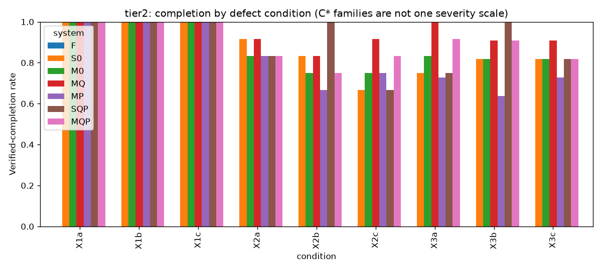
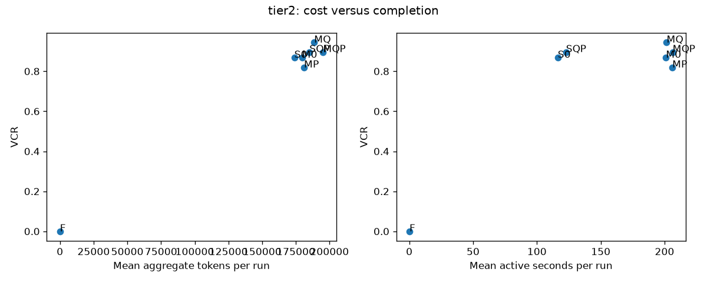
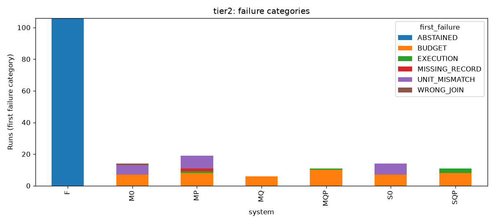

# Tier2 calibration pilot E0X report

> Pilot (E0) on separate development tasks. Not part of confirmatory scores. Used to calibrate limits, estimate variance and cost, and freeze the protocol.

> Tier-2 calibration pilot E0X (main-plan-v2.1), recorded separately from E0.

## 1. Verified-completion rate (recoverable runs)

| system | attempted | verified | VCR | VCR_family_weighted |
|---|---|---|---|---|
| F | 106 | 0 | 0.000 | 0.000 |
| S0 | 106 | 92 | 0.868 | 0.868 |
| M0 | 106 | 92 | 0.868 | 0.869 |
| MQ | 106 | 100 | 0.943 | 0.943 |
| MP | 105 | 86 | 0.819 | 0.820 |
| SQP | 106 | 95 | 0.896 | 0.896 |
| MQP | 106 | 95 | 0.896 | 0.897 |

### By dataset family
| system | D5 | D6 |
|---|---|---|
| F | 0.000 | 0.000 |
| M0 | 0.833 | 0.904 |
| MP | 0.778 | 0.863 |
| MQ | 0.944 | 0.942 |
| MQP | 0.852 | 0.942 |
| S0 | 0.852 | 0.885 |
| SQP | 0.889 | 0.904 |

### By condition
| system | X1a | X1b | X1c | X2a | X2b | X2c | X3a | X3b | X3c |
|---|---|---|---|---|---|---|---|---|---|
| F | 0.000 | 0.000 | 0.000 | 0.000 | 0.000 | 0.000 | 0.000 | 0.000 | 0.000 |
| M0 | 1.000 | 1.000 | 1.000 | 0.833 | 0.750 | 0.750 | 0.833 | 0.818 | 0.818 |
| MP | 1.000 | 1.000 | 1.000 | 0.833 | 0.667 | 0.750 | 0.727 | 0.636 | 0.727 |
| MQ | 1.000 | 1.000 | 1.000 | 0.917 | 0.833 | 0.917 | 1.000 | 0.909 | 0.909 |
| MQP | 1.000 | 1.000 | 1.000 | 0.833 | 0.750 | 0.833 | 0.917 | 0.909 | 0.818 |
| S0 | 1.000 | 1.000 | 1.000 | 0.917 | 0.833 | 0.667 | 0.750 | 0.818 | 0.818 |
| SQP | 1.000 | 1.000 | 1.000 | 0.833 | 1.000 | 0.667 | 0.750 | 1.000 | 0.818 |

### Attempt counts by condition
| system | X1a | X1b | X1c | X2a | X2b | X2c | X3a | X3b | X3c |
|---|---|---|---|---|---|---|---|---|---|
| F | 12 | 12 | 12 | 12 | 12 | 12 | 12 | 11 | 11 |
| M0 | 12 | 12 | 12 | 12 | 12 | 12 | 12 | 11 | 11 |
| MP | 12 | 12 | 12 | 12 | 12 | 12 | 11 | 11 | 11 |
| MQ | 12 | 12 | 12 | 12 | 12 | 12 | 12 | 11 | 11 |
| MQP | 12 | 12 | 12 | 12 | 12 | 12 | 12 | 11 | 11 |
| S0 | 12 | 12 | 12 | 12 | 12 | 12 | 12 | 11 | 11 |
| SQP | 12 | 12 | 12 | 12 | 12 | 12 | 12 | 11 | 11 |

## 2. Paired effects (percentage points; family-weighted; block bootstrap within family)

| contrast | estimate_pp | ci_low_pp | ci_high_pp | p_sign_flip | families | blocks | paired_cells | lofo_min_pp | lofo_max_pp | role | p_holm |
|---|---|---|---|---|---|---|---|---|---|---|---|
| H1: MQP - M0 | 2.849 | 2.849 | 2.849 | 0.500 | 2 | 2 | 106 | 1.852 | 3.846 | primary |  |
| Q main effect | 7.571 | 7.571 | 7.571 | 0.500 | 2 | 2 | 105 | 5.882 | 9.259 | secondary | 1.000 |
| P main effect | -4.684 | -4.684 | -4.684 | 0.500 | 2 | 2 | 105 | -7.407 | -1.961 | secondary | 1.000 |
| Q x P interaction | 0.109 | 0.109 | 0.109 | 1.000 | 2 | 2 | 105 | -3.704 | 3.922 | secondary | 1.000 |
| MQP - SQP | 0.071 | 0.071 | 0.071 | 1.000 | 2 | 2 | 106 | -3.704 | 3.846 | secondary | 1.000 |
| MQP - F | 89.708 | 89.708 | 89.708 | 0.500 | 2 | 2 | 106 | 85.185 | 94.231 | secondary | 1.000 |
| M0 - S0 | 0.036 | 0.036 | 0.036 | 1.000 | 2 | 2 | 106 | -1.852 | 1.923 | exploratory |  |
| SQP - S0 | 2.813 | 2.813 | 2.813 | 0.500 | 2 | 2 | 106 | 1.923 | 3.704 | exploratory |  |

Failure to reject a difference is not evidence of equivalence. With three repetition blocks per family the bootstrap interval can be unstable.

## 3. Predictive quality
| system | verified_runs | mean_skill_verified | mean_unclipped_skill_all_scored | mean_verified_utility_all_attempts |
|---|---|---|---|---|
| F |  |  |  | 0.000 |
| M0 | 92.000 | 0.518 | 0.510 | 0.449 |
| MP | 86.000 | 0.518 | 0.511 | 0.424 |
| MQ | 100.000 | 0.508 | 0.508 | 0.479 |
| MQP | 95.000 | 0.520 | 0.520 | 0.466 |
| S0 | 92.000 | 0.512 | 0.505 | 0.445 |
| SQP | 95.000 | 0.510 | 0.510 | 0.457 |

### Raw metrics of verified runs
| family | system | n | ap | macro_f1 | rmse | mae |
|---|---|---|---|---|---|---|
| D5 | M0 | 45 | 0.377 | 0.555 |  |  |
| D5 | MP | 42 | 0.378 | 0.554 |  |  |
| D5 | MQ | 51 | 0.377 | 0.555 |  |  |
| D5 | MQP | 46 | 0.378 | 0.555 |  |  |
| D5 | S0 | 46 | 0.377 | 0.555 |  |  |
| D5 | SQP | 48 | 0.378 | 0.555 |  |  |
| D6 | M0 | 47 |  |  | 2.099 | 1.690 |
| D6 | MP | 44 |  |  | 2.098 | 1.690 |
| D6 | MQ | 49 |  |  | 2.099 | 1.690 |
| D6 | MQP | 49 |  |  | 2.098 | 1.690 |
| D6 | S0 | 46 |  |  | 2.098 | 1.690 |
| D6 | SQP | 47 |  |  | 2.099 | 1.690 |

## 4. Cost and efficiency
| system | runs | mean_tokens | p90_tokens | mean_model_calls | mean_tool_calls | mean_gate_calls | mean_repairs | mean_fits | mean_active_s | p90_active_s | mean_llm_s | verified | tokens_per_verified | active_s_per_verified |
|---|---|---|---|---|---|---|---|---|---|---|---|---|---|---|
| F | 106 | 0.0 | 0.0 | 0.0 | 2.0 | 1.7 | 0.0 | 0.0 | 0.2 | 0.3 | 0.0 | 0 |  |  |
| M0 | 106 | 179563.7 | 273053.0 | 26.5 | 23.1 | 0.0 | 0.0 | 23.8 | 201.1 | 263.7 | 193.7 | 92 | 206888.6 | 231.7 |
| MP | 105 | 181088.4 | 289072.2 | 26.7 | 23.0 | 7.6 | 0.0 | 23.7 | 206.1 | 275.6 | 198.7 | 86 | 221096.3 | 251.6 |
| MQ | 106 | 188613.4 | 278228.0 | 27.2 | 23.8 | 7.7 | 0.1 | 23.7 | 201.6 | 260.5 | 194.2 | 100 | 199930.2 | 213.7 |
| MQP | 106 | 195252.2 | 297807.0 | 27.6 | 24.3 | 14.9 | 0.1 | 23.1 | 206.3 | 276.4 | 199.1 | 95 | 217860.3 | 230.2 |
| S0 | 106 | 173910.8 | 251348.5 | 18.3 | 18.2 | 0.0 | 0.0 | 24.0 | 116.3 | 155.2 | 108.9 | 92 | 200375.4 | 134.0 |
| SQP | 106 | 185130.2 | 269846.5 | 18.8 | 18.5 | 14.7 | 0.1 | 22.6 | 122.8 | 171.6 | 115.8 | 95 | 206566.3 | 137.0 |

## 5. Failure categories and reliability
| system | ABSTAINED | BUDGET | EXECUTION | MISSING_RECORD | UNIT_MISMATCH | WRONG_JOIN |
|---|---|---|---|---|---|---|
| F | 106 | 0 | 0 | 0 | 0 | 0 |
| M0 | 0 | 7 | 0 | 0 | 6 | 1 |
| MP | 0 | 8 | 1 | 2 | 8 | 0 |
| MQ | 0 | 6 | 0 | 0 | 0 | 0 |
| MQP | 0 | 10 | 1 | 0 | 0 | 0 |
| S0 | 0 | 7 | 0 | 0 | 7 | 0 |
| SQP | 0 | 8 | 3 | 0 | 0 | 0 |
| system | invalid_submission_rate | submission_error_rate | recoverable_abstention_rate |
|---|---|---|---|
| F | 0.000 |  | 1.000 |
| M0 | 0.066 | 0.071 | 0.000 |
| MP | 0.095 | 0.104 | 0.000 |
| MQ | 0.000 | 0.000 | 0.000 |
| MQP | 0.000 | 0.000 | 0.000 |
| S0 | 0.066 | 0.071 | 0.000 |
| SQP | 0.000 | 0.000 | 0.000 |
### Terminal states
| system | ABSTAINED | BUDGET_EXCEEDED | EXECUTION_ERROR | SUBMITTED |
|---|---|---|---|---|
| F | 106 | 0 | 0 | 0 |
| M0 | 0 | 7 | 0 | 99 |
| MP | 0 | 8 | 1 | 96 |
| MQ | 0 | 6 | 0 | 100 |
| MQP | 0 | 10 | 1 | 95 |
| S0 | 0 | 7 | 0 | 99 |
| SQP | 0 | 8 | 3 | 95 |

## 6. Negative controls (unrecoverable tasks)
_no data_

## Tier-2 calibration (prespecified rule)
Rule: argmin |VCR(S0,M0 pooled) - 0.5| per defect; ties -> lower level. Runs pending: 15 of 756.

- X1: chosen level **X1a** (complete); X1a: S0+M0 VCR 1.0 (n=24); X1b: S0+M0 VCR 1.0 (n=24); X1c: S0+M0 VCR 1.0 (n=24)
- X2: chosen level **X2c** (complete); X2a: S0+M0 VCR 0.875 (n=24); X2b: S0+M0 VCR 0.792 (n=24); X2c: S0+M0 VCR 0.708 (n=24)
- X3: chosen level **X3a** (complete); X3a: S0+M0 VCR 0.792 (n=24); X3b: S0+M0 VCR 0.818 (n=22); X3c: S0+M0 VCR 0.818 (n=22)

## 15. Ceiling check (main-plan-v2.md, E0)
M0 pilot VCR: 0.868 (threshold 0.95). Agentic systems at 100%: none.
No ceiling warning.

## Figures

