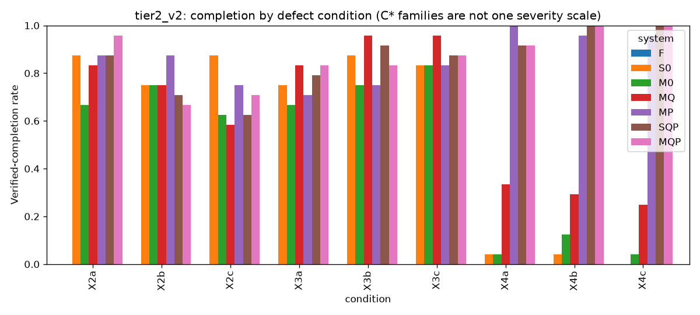
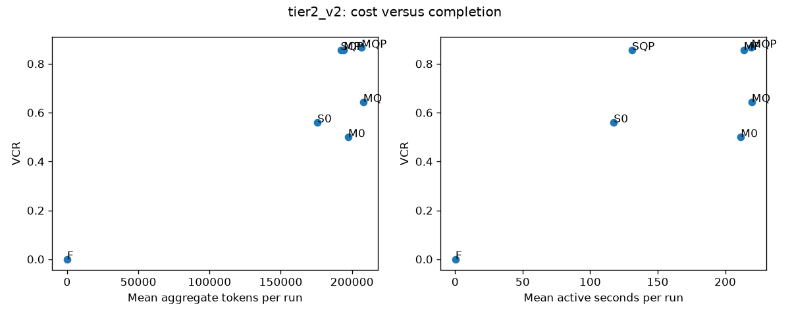
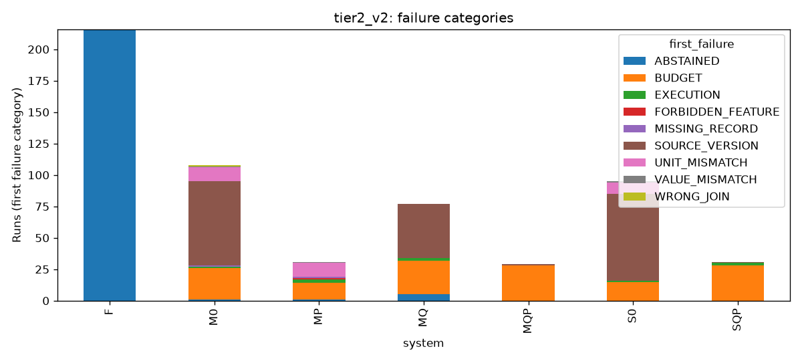

# Tier2_v2 calibration pilot E0X2 report

> Pilot (E0) on separate development tasks. Not part of confirmatory scores. Used to calibrate limits, estimate variance and cost, and freeze the protocol.

> Tier-2 calibration pilot E0X2 (main-plan-v2.1), recorded separately from E0.

## 1. Verified-completion rate (recoverable runs)

| system | attempted | verified | VCR | VCR_family_weighted |
|---|---|---|---|---|
| F | 216 | 0 | 0.000 | 0.000 |
| S0 | 216 | 121 | 0.560 | 0.560 |
| M0 | 216 | 108 | 0.500 | 0.500 |
| MQ | 216 | 139 | 0.644 | 0.644 |
| MP | 216 | 185 | 0.856 | 0.856 |
| SQP | 216 | 185 | 0.856 | 0.856 |
| MQP | 216 | 187 | 0.866 | 0.866 |

### By dataset family
| system | D5 | D6 |
|---|---|---|
| F | 0.000 | 0.000 |
| M0 | 0.500 | 0.500 |
| MP | 0.870 | 0.843 |
| MQ | 0.620 | 0.667 |
| MQP | 0.852 | 0.880 |
| S0 | 0.481 | 0.639 |
| SQP | 0.815 | 0.898 |

### By condition
| system | X2a | X2b | X2c | X3a | X3b | X3c | X4a | X4b | X4c |
|---|---|---|---|---|---|---|---|---|---|
| F | 0.000 | 0.000 | 0.000 | 0.000 | 0.000 | 0.000 | 0.000 | 0.000 | 0.000 |
| M0 | 0.667 | 0.750 | 0.625 | 0.667 | 0.750 | 0.833 | 0.042 | 0.125 | 0.042 |
| MP | 0.875 | 0.875 | 0.750 | 0.708 | 0.750 | 0.833 | 1.000 | 0.958 | 0.958 |
| MQ | 0.833 | 0.750 | 0.583 | 0.833 | 0.958 | 0.958 | 0.333 | 0.292 | 0.250 |
| MQP | 0.958 | 0.667 | 0.708 | 0.833 | 0.833 | 0.875 | 0.917 | 1.000 | 1.000 |
| S0 | 0.875 | 0.750 | 0.875 | 0.750 | 0.875 | 0.833 | 0.042 | 0.042 | 0.000 |
| SQP | 0.875 | 0.708 | 0.625 | 0.792 | 0.917 | 0.875 | 0.917 | 1.000 | 1.000 |

### Attempt counts by condition
| system | X2a | X2b | X2c | X3a | X3b | X3c | X4a | X4b | X4c |
|---|---|---|---|---|---|---|---|---|---|
| F | 24 | 24 | 24 | 24 | 24 | 24 | 24 | 24 | 24 |
| M0 | 24 | 24 | 24 | 24 | 24 | 24 | 24 | 24 | 24 |
| MP | 24 | 24 | 24 | 24 | 24 | 24 | 24 | 24 | 24 |
| MQ | 24 | 24 | 24 | 24 | 24 | 24 | 24 | 24 | 24 |
| MQP | 24 | 24 | 24 | 24 | 24 | 24 | 24 | 24 | 24 |
| S0 | 24 | 24 | 24 | 24 | 24 | 24 | 24 | 24 | 24 |
| SQP | 24 | 24 | 24 | 24 | 24 | 24 | 24 | 24 | 24 |

## 2. Paired effects (percentage points; family-weighted; block bootstrap within family)

| contrast | estimate_pp | ci_low_pp | ci_high_pp | p_sign_flip | families | blocks | paired_cells | lofo_min_pp | lofo_max_pp | role | p_holm |
|---|---|---|---|---|---|---|---|---|---|---|---|
| H1: MQP - M0 | 36.574 | 33.333 | 39.815 | 0.117 | 2 | 4 | 216 | 35.185 | 37.963 | primary |  |
| Q main effect | 7.639 | 5.093 | 10.185 | 0.117 | 2 | 4 | 216 | 5.093 | 10.185 | secondary | 0.587 |
| P main effect | 28.935 | 28.241 | 29.630 | 0.117 | 2 | 4 | 216 | 27.778 | 30.093 | secondary | 0.587 |
| Q x P interaction | -13.426 | -22.222 | -4.630 | 0.117 | 2 | 4 | 216 | -13.889 | -12.963 | secondary | 0.587 |
| MQP - SQP | 0.926 | -2.778 | 4.630 | 0.749 | 2 | 4 | 216 | -1.852 | 3.704 | secondary | 0.749 |
| MQP - F | 86.574 | 84.259 | 88.889 | 0.117 | 2 | 4 | 216 | 85.185 | 87.963 | secondary | 0.587 |
| M0 - S0 | -6.019 | -8.333 | -3.704 | 0.374 | 2 | 4 | 216 | -13.889 | 1.852 | exploratory |  |
| SQP - S0 | 29.630 | 28.704 | 30.556 | 0.117 | 2 | 4 | 216 | 25.926 | 33.333 | exploratory |  |

Failure to reject a difference is not evidence of equivalence. With three repetition blocks per family the bootstrap interval can be unstable.

## 3. Predictive quality
| system | verified_runs | mean_skill_verified | mean_unclipped_skill_all_scored | mean_verified_utility_all_attempts |
|---|---|---|---|---|
| F |  |  |  | 0.000 |
| M0 | 108.000 | 0.480 | 0.471 | 0.118 |
| MP | 185.000 | 0.460 | 0.463 | 0.198 |
| MQ | 139.000 | 0.475 | 0.481 | 0.158 |
| MQP | 187.000 | 0.487 | 0.487 | 0.216 |
| S0 | 121.000 | 0.511 | 0.486 | 0.147 |
| SQP | 185.000 | 0.484 | 0.484 | 0.213 |

### Raw metrics of verified runs
| family | system | n | ap | macro_f1 | rmse | mae |
|---|---|---|---|---|---|---|
| D5 | M0 | 54 | 0.362 | 0.546 |  |  |
| D5 | MP | 94 | 0.356 | 0.542 |  |  |
| D5 | MQ | 67 | 0.354 | 0.542 |  |  |
| D5 | MQP | 92 | 0.359 | 0.544 |  |  |
| D5 | S0 | 52 | 0.357 | 0.542 |  |  |
| D5 | SQP | 88 | 0.356 | 0.541 |  |  |
| D6 | M0 | 54 |  |  | 1.961 | 1.552 |
| D6 | MP | 91 |  |  | 1.960 | 1.552 |
| D6 | MQ | 72 |  |  | 1.960 | 1.551 |
| D6 | MQP | 95 |  |  | 1.964 | 1.553 |
| D6 | S0 | 69 |  |  | 1.963 | 1.553 |
| D6 | SQP | 97 |  |  | 1.961 | 1.552 |

## 4. Cost and efficiency
| system | runs | mean_tokens | p90_tokens | mean_model_calls | mean_tool_calls | mean_gate_calls | mean_repairs | mean_fits | mean_active_s | p90_active_s | mean_llm_s | verified | tokens_per_verified | active_s_per_verified |
|---|---|---|---|---|---|---|---|---|---|---|---|---|---|---|
| F | 216 | 0.0 | 0.0 | 0.0 | 2.0 | 2.0 | 0.0 | 0.0 | 0.3 | 0.4 | 0.0 | 0 |  |  |
| M0 | 216 | 197353.0 | 301343.5 | 27.0 | 23.6 | 0.0 | 0.0 | 22.7 | 211.5 | 280.9 | 204.3 | 108 | 394706.0 | 423.1 |
| MP | 216 | 194213.6 | 276870.5 | 27.3 | 23.8 | 7.9 | 0.2 | 23.9 | 213.8 | 275.9 | 206.0 | 185 | 226757.5 | 249.6 |
| MQ | 216 | 207940.2 | 301908.0 | 28.2 | 24.8 | 7.3 | 0.1 | 22.4 | 219.6 | 301.6 | 212.4 | 139 | 323130.0 | 341.3 |
| MQP | 216 | 206679.4 | 302166.5 | 28.2 | 24.7 | 15.3 | 0.3 | 22.9 | 219.5 | 283.1 | 212.0 | 187 | 238731.2 | 253.5 |
| S0 | 216 | 175677.6 | 263256.5 | 18.1 | 17.9 | 0.0 | 0.0 | 23.2 | 117.5 | 165.2 | 110.2 | 121 | 313606.4 | 209.7 |
| SQP | 216 | 192082.5 | 305703.5 | 19.0 | 18.7 | 14.9 | 0.4 | 22.0 | 131.1 | 176.8 | 124.0 | 185 | 224269.3 | 153.0 |

## 5. Failure categories and reliability
| system | ABSTAINED | BUDGET | EXECUTION | FORBIDDEN_FEATURE | MISSING_RECORD | SOURCE_VERSION | UNIT_MISMATCH | VALUE_MISMATCH | WRONG_JOIN |
|---|---|---|---|---|---|---|---|---|---|
| F | 216 | 0 | 0 | 0 | 0 | 0 | 0 | 0 | 0 |
| M0 | 1 | 25 | 1 | 0 | 1 | 67 | 11 | 1 | 1 |
| MP | 1 | 13 | 3 | 1 | 1 | 0 | 11 | 1 | 0 |
| MQ | 5 | 27 | 2 | 0 | 0 | 43 | 0 | 0 | 0 |
| MQP | 0 | 28 | 0 | 0 | 0 | 1 | 0 | 0 | 0 |
| S0 | 0 | 15 | 1 | 0 | 0 | 69 | 9 | 1 | 0 |
| SQP | 0 | 28 | 2 | 0 | 0 | 1 | 0 | 0 | 0 |
| system | invalid_submission_rate | submission_error_rate | recoverable_abstention_rate |
|---|---|---|---|
| F | 0.000 |  | 1.000 |
| M0 | 0.375 | 0.429 | 0.005 |
| MP | 0.065 | 0.070 | 0.005 |
| MQ | 0.199 | 0.236 | 0.023 |
| MQP | 0.005 | 0.005 | 0.000 |
| S0 | 0.366 | 0.395 | 0.000 |
| SQP | 0.005 | 0.005 | 0.000 |
### Terminal states
| system | ABSTAINED | BUDGET_EXCEEDED | EXECUTION_ERROR | SUBMITTED |
|---|---|---|---|---|
| F | 216 | 0 | 0 | 0 |
| M0 | 1 | 25 | 1 | 189 |
| MP | 1 | 13 | 3 | 199 |
| MQ | 5 | 27 | 2 | 182 |
| MQP | 0 | 28 | 0 | 188 |
| S0 | 0 | 15 | 1 | 200 |
| SQP | 0 | 28 | 2 | 186 |

## 6. Negative controls (unrecoverable tasks)
_no data_

## Tier-2 calibration (prespecified rule)
Rule: argmin |VCR(S0,M0 pooled) - 0.5| per defect; ties -> lower level. Runs pending: 0 of 1512.

- X2: chosen level **X2b** (complete); X2a: S0+M0 VCR 0.771 (n=48); X2b: S0+M0 VCR 0.75 (n=48); X2c: S0+M0 VCR 0.75 (n=48)
- X3: chosen level **X3a** (complete); X3a: S0+M0 VCR 0.708 (n=48); X3b: S0+M0 VCR 0.812 (n=48); X3c: S0+M0 VCR 0.833 (n=48)
- X4: chosen level **X4b** (complete); X4a: S0+M0 VCR 0.042 (n=48); X4b: S0+M0 VCR 0.083 (n=48); X4c: S0+M0 VCR 0.021 (n=48)

## 15. Ceiling check (main-plan-v2.md, E0)
M0 pilot VCR: 0.500 (threshold 0.95). Agentic systems at 100%: none.
No ceiling warning.

## Figures

